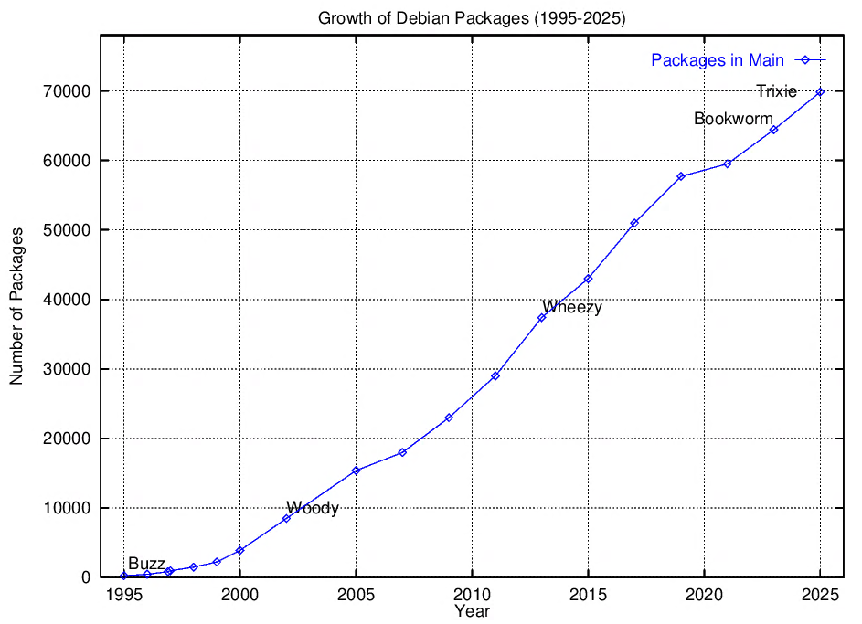

# Debian History Paper


> A LaTeX project documenting the history of Debian package growth, used as a benchmark for TeX workflow compatibility across three decades of Debian releases.

## 📖 Overview

This repository contains a LaTeX document that visualizes the exponential growth of the Debian package repository from 1995 to the present day.

Beyond generating a chart, the primary purpose of this project is to serve as a **compatibility test case**. It is intended to be compiled on various Debian releases running in emulated environments (QEMU/VirtualBox), ranging from the vintage **Debian 0.93R6 (1995)** to the upcoming **Debian 13.0 (Trixie)**.

## 📊 Output Preview


*Figure 1: The trajectory of available software packages in Debian stable releases over time.*

## 🛠️ Prerequisites

The source targets the tools available around Debian 0.93R6. It uses
LaTeX 2.09 document syntax, also accepted by LaTeX2e in compatibility mode,
and Gnuplot 3.5 syntax.

The intended archive packages are `gnuplot-3.5-3.deb` and
`texbin-3.1415-3.deb`. The latter identifies the TeX engine version,
not the version of the installed LaTeX format.

You need the following commands and macro file (historical package names
may differ):

* `latex` with the standard `article` style and Computer Modern fonts
* `gnuplot` with the PostScript terminal
* `bibtex` with the standard `plain.bst` bibliography style
* `dvips` and its `epsf.tex` macros for EPS inclusion

The TeX and BibTeX sources contain only ASCII characters. They do not require
`inputenc`, T1 fonts, `geometry`, `url`, `graphicx`, `pgfplots`, or `biblatex`.
Page dimensions use TeX lengths; `dvips -t a4` selects physical A4 paper.

## 🚀 Usage

### Standard Compilation (Old Debian)

Run these commands from the repository directory, on either an old system
or a modern TeX installation:

```bash
# 1. Prepare the plot
gnuplot plot.gp

# 2. Compile the document structure
latex debian_intro.tex

# 3. Process the bibliography
bibtex debian_intro

# 4. Link citations and resolve cross-references
latex debian_intro.tex
latex debian_intro.tex

# 5. Convert to A4 PostScript for viewing/printing
dvips -t a4 debian_intro.dvi -o debian_intro.ps
```

For an optional PDF on a modern machine with Ghostscript installed:

```bash
ps2pdf debian_intro.ps debian_intro.pdf
```

### Compatibility notes

* Gnuplot 3.5 accepts positional line/point types such as `linespoints 2 7`;
  modern Gnuplot rejects them. The script uses `with linespoints` with default
  types, which works in both versions. Do not replace it with modern `lt`/`pt`
  options when targeting Gnuplot 3.5.
* If LaTeX cannot find `epsf.tex`, install the EPS macros from the matching
  dvips/TeX distribution, or add their directory to the TeX search path.
  On current Debian, `texlive-plain-generic` supplies this file.
* A modern LaTeX installation reports that it is using LaTeX 2.09 compatibility
  mode. This is expected for this document.
* The script has been tested with Gnuplot 3.5 (built on modern Linux) and
  Gnuplot 6.0.2. The full LaTeX/BibTeX/dvips workflow has been tested with
  modern LaTeX in 2.09 compatibility mode. Compilation inside an actual
  Debian 0.93 installation, using its original TeX macros and fonts, remains
  unverified.
